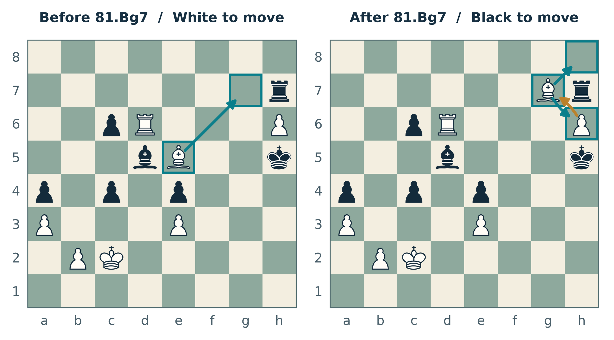
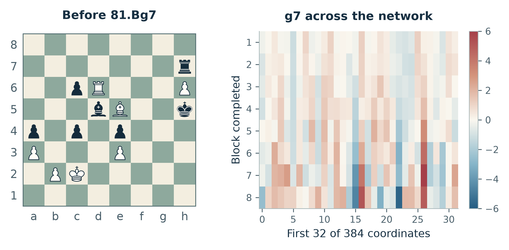
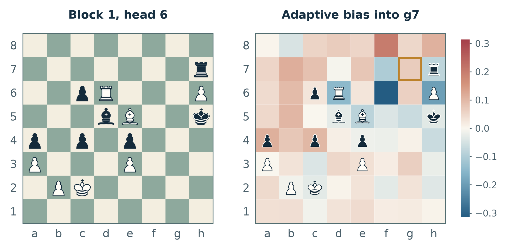
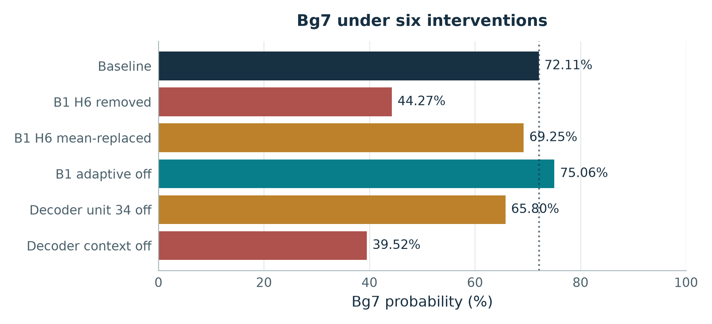
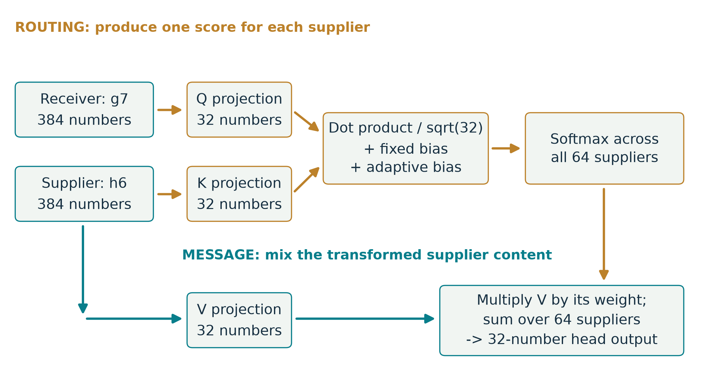

# VEGAM
### A small transformer. A very large chessboard.

**A personally built and trained neural chess evaluator, paired with Lc0-derived search.**

By [Remmy Victor · @vikta03](https://github.com/vikta03)

[Play with it](docs/INSTALL.md) · [Inside the network](book/README.md) · [Architecture](docs/ARCHITECTURE.md) · [Experiments](research/README.md) · [Downloads](https://github.com/vikta03/vegam/releases)

**What can you learn from a bishop move?**

Quite a lot. Follow **81.Bg7** from a real game through the board encoder,
attention heads, adaptive relations, hidden activations, move decoder and search.
Then intervene on those internal signals and measure what changes.

VEGAM brings the engine, its trained weights, the experiments and an illustrated
102-page technical book into one project.

**In 30 seconds:** I built and trained the **9.8M-parameter chess model**,
integrated it with Lc0-derived search, and made its internals visible. You can
**[play the engine](docs/INSTALL.md)**,
**[read the illustrated book](https://github.com/vikta03/vegam/releases/download/v1.0.0/inside-vegam.pdf)**,
or **[watch the bishop reel](https://github.com/vikta03/vegam/releases/download/v1.0.0/inside-vegam-bishop-reel.mp4)**.
The investigation also produced upstream bug reports, including a merged Lc0 fix.

For the complementary CPU approach, see **[FORGE](https://github.com/vikta03/forge)**:
incremental learned evaluation, specialist networks, and a 3D model explorer.

## The engine

<strong>Technical specifications and source lineage</strong>

| | VEGAM-TF3-Q |
|---|---|
| Network | 9,800,012 parameters; eight transformer blocks |
| Board representation | 64 square tokens, 120 channels, eight historical boards |
| Hidden width | 384; 12 attention heads; 576-wide feed-forward layers |
| Relations | Learned static square relations plus position-dependent rank-16 relations |
| Outputs | Policy, position WDL, action WDL, outcome and duration |
| Daily search | Corrected classic MCTS; action-Q advice on unvisited moves |
| Inference | ONNX Runtime CPU/CUDA; locally compiled mixed-precision TensorRT |
| Initial platform | Linux x86-64, with NVIDIA acceleration |

The evaluation has no hand-written piece values, piece-square tables, mobility
bonuses or king-safety score. Chess rules, history encoding and the move
representation are designed. The learned targets come from Lc0 training records.

The model architecture, training pipeline, export and inference integration are
VEGAM work. Move generation, the search framework, time management and UCI are
derived from **[Leela Chess Zero](https://github.com/LeelaChessZero/lc0)**.
The boundaries and exact source lineage are documented in [Architecture](docs/ARCHITECTURE.md).

## Look inside

The book follows a measured position rather than attaching chess labels to
unexplained heatmaps. It covers the equations, actual tensor shapes, training
targets, worked numerical examples, intervention results and what each method
can and cannot establish.

<table>
<tr>
<td></td>
<td></td>
</tr>
<tr><td>The evolving square representation</td><td>Learned, position-dependent relations</td></tr>
<tr>
<td></td>
<td></td>
</tr>
<tr><td>Intervene, then measure</td><td>Routing is distinct from message content</td></tr>
</table>

**[Read Inside VEGAM](https://github.com/vikta03/vegam/releases/download/v1.0.0/inside-vegam.pdf)**
— 15 chapters, 31 figures, 23 equation groups and 24 exercises with answers.
The [book source and frozen measurements](book/README.md) are included.
There is also a [silent bishop reel](https://github.com/vikta03/vegam/releases/download/v1.0.0/inside-vegam-bishop-reel.mp4).

## Play and reproduce

Start with the [Linux installation guide](docs/INSTALL.md). Download the release
package, install its pinned runtime, and add `vegamt-tf3-q` to any UCI-compatible
chess GUI. TensorRT preparation is a separate, explicit GPU job.
The initial prebuilt binary requires glibc 2.43; older Linux systems should build
from the included source.

For source builds, see [Build and verification](docs/BUILD.md). For the data
format, training configuration and export sequence, see [Training](docs/TRAINING.md)
and the [model card](MODEL_CARD.md).

## What the evidence says

On the development laptop—an RTX 3050 Laptop GPU with 4 GiB VRAM—the corrected
classic engine recorded about **6,200–6,500 GUI-reported NPS** in a small saved
position screen. Its tactical queen-sacrifice position was closer to 5,150 NPS.
These are historical measurements with specified settings, not universal
performance promises or a published Elo rating.

Some promising ideas did **not** earn promotion:

- A 20-game DAG/classic screen ended **4 wins, 12 draws, 4 losses** for DAG.
- The stopped Q-head screen ended **1 win, 9 draws, 1 loss** in 11 games.
  Q remains a deliberate experimental default, not a demonstrated strength gain.
- Internal traces helped expose both real search defects and hypotheses that
  did not survive checking.

[Experiments and receipts](research/README.md) separate performance, correctness
and playing strength. The [Catalan game](research/evidence/catalan.pgn) is an
illustrative game, not a controlled strength test.

## Work that reached upstream

The investigation produced three Lc0 reports:

| Finding | Upstream |
|---|---|
| FEN fullmove numbers converted incorrectly to elapsed plies | [Report #2471](https://github.com/LeelaChessZero/lc0/issues/2471); [fix #2480](https://github.com/LeelaChessZero/lc0/pull/2480), merged 20 October 2026 |
| Terminal-draw comparator violated strict weak ordering | [Report #2470](https://github.com/LeelaChessZero/lc0/issues/2470); [fix #2481](https://github.com/LeelaChessZero/lc0/pull/2481), open |
| Unusable en-passant markers affected repetition identity | [Report #2469](https://github.com/LeelaChessZero/lc0/issues/2469), open |

Status checked 20 October 2026. Upstream maintainers and patch contributors
retain their own credit. Local fixes and regression evidence are included here;
acceptance of a correctness fix does not establish an Elo gain.

## Licence and credits

Engine and project code: **GPL-3.0-or-later**, with retained upstream permissions
and notices. Original model weights and writing: **CC BY 4.0**.
Third-party artwork and dependencies retain their separate licences.
See [licence boundaries](LICENSE.md), [third-party notices](THIRD_PARTY.md)
and [source provenance](provenance/README.md).
