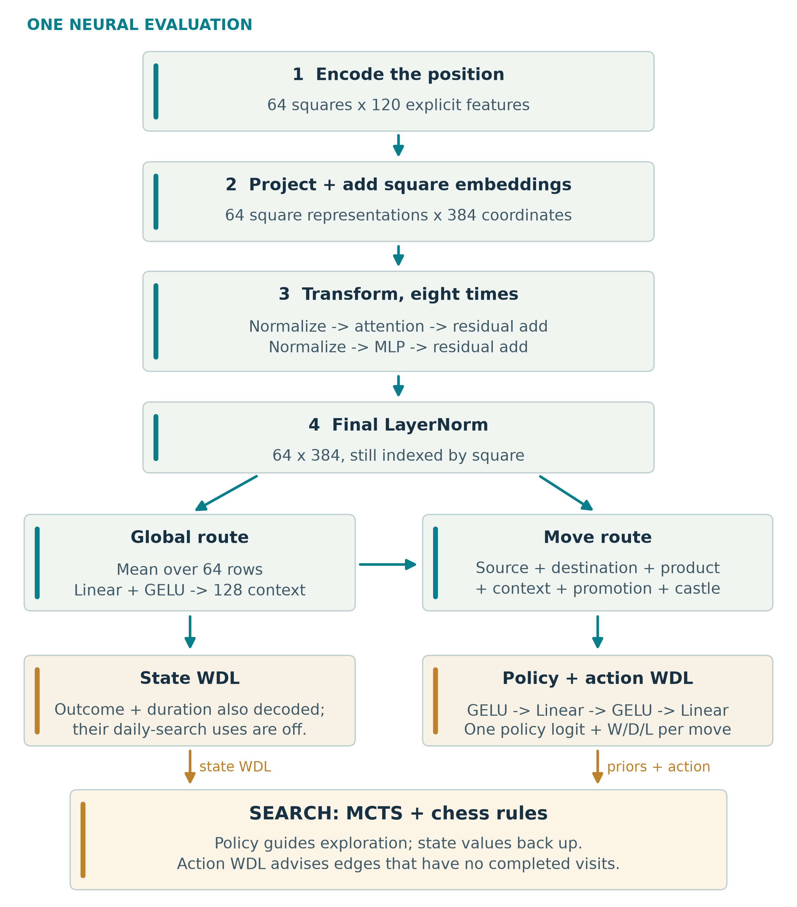

# The network and the engine

VEGAM's trained evaluator is an eight-block transformer over 64 square tokens.
Each square receives 120 channels: eight frames of pieces and repetition,
castling rights, side to move, reversible clock, en-passant information,
history-presence flags and a constant. It does not receive a conventional
hand-written chess evaluation.

A projection and learned square embedding produce 384 coordinates per square.
Each block combines 12-head attention, learned static square relations,
position-dependent rank-16 relation factors, residual connections and a
576-unit feed-forward network. The complete checkpoint contains 9,800,012 parameters.

The global readout predicts position W/D/L, outcome and duration. A shared
move decoder reads source square, destination square, their interaction,
global context, promotion and castling features to produce policy and action W/D/L.

## What search uses

The public default is classic Lc0-derived MCTS with the Fixed3 corrections.
Policy supplies exploration priors; position WDL supplies leaf values.
For an unvisited edge, action-Q contributes 25% of its initial estimate and
ordinary first-play urgency contributes 75%. Once the edge has a completed
visit, search uses its backed-up value.

The outcome blend and moves-left utility are disabled. Root Scout, alternate
cache experiments and later unpromoted search mechanisms are not enabled.
Corrected DAG source remains available as an explicitly experimental search;
it is not the default launcher.

## Attribution boundary

- **VEGAM:** model architecture and weights, record decoding/training pipeline,
  model exports, `next-ort` integration, action-head integration, investigations
  and documented local corrections.
- **Lc0:** the chess rules, legal move generation, main search architecture,
  tree machinery, time management, UCI and other retained engine infrastructure.
- **Teacher/data:** the model starts from random weights but learns from Lc0
  records. Random initialization does not mean learning without a teacher.

The engine fork starts at Lc0 v0.32.0 commit
`b38ed00a25baed9554d2675ec376bd50dad18195`; common protocol sources are pinned to
`b326b154221a6eb91977bdccf11d6f89e8547875`.
Original authors and licence headers remain in the source.
See [provenance](../provenance/README.md).
